# Atalanta

**Read at the speed of myth. Stop for what shines.**

A speed reader (one word at a time) for `.epub`, `.mobi` and `.pdf` books, built with Rust + Tauri.
When you pause, it shows the full text, where you can choose where to continue and highlight
passages that are saved as Markdown notes for Obsidian.

<p align="center">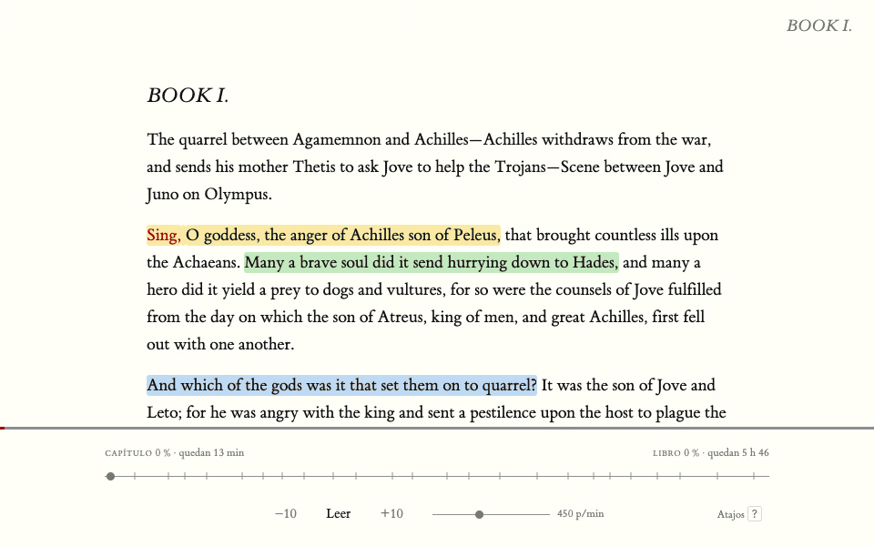</p>

> The interface is in Spanish for now. The screenshots use *The Iliad* in Samuel Butler's translation.

## Why Atalanta

In Greek myth, Atalanta was the fastest runner in Greece: no one could beat her in a race.
Hippomenes finally did, with a trick. He dropped three golden apples along the way, and she
stopped to pick them up.

This app does the same, on purpose:

| The myth | The app |
|---|---|
| Outrun everyone | Read word by word, at the speed you choose (100 to 1000 words per minute) |
| Stop mid-race | Pause: the word flies back to its place and you see the whole book |
| Pick up the golden apples | Highlight the lines worth keeping and save them to Obsidian |

This time nobody loses the race: you keep the apples.

## Run

One word at a time, with the anchor letter in color so your eyes stay still. The rhythm is
natural: longer on commas, periods, paragraph ends and changes of speaker in dialogue, with a
gradual start each time you resume. If you want context, the neighboring words show on either side.

<p align="center">
  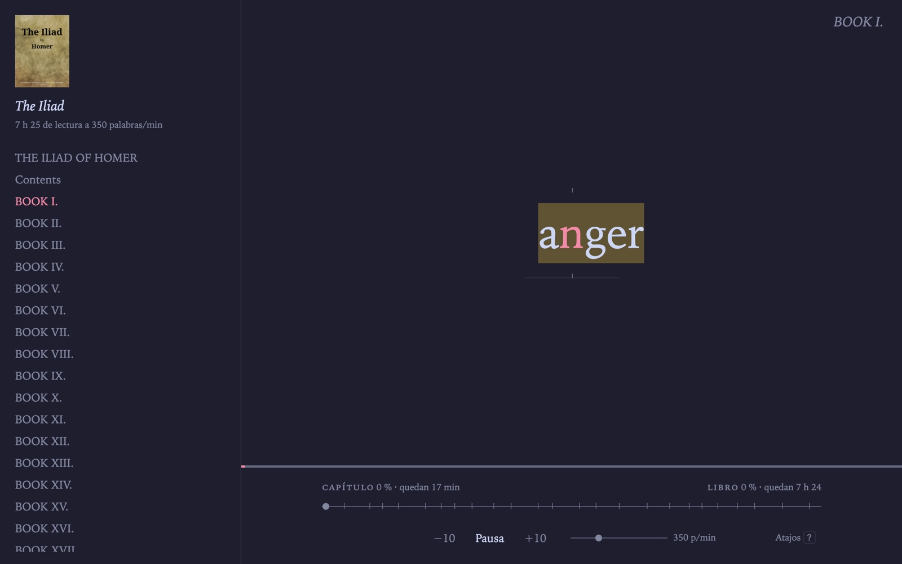
  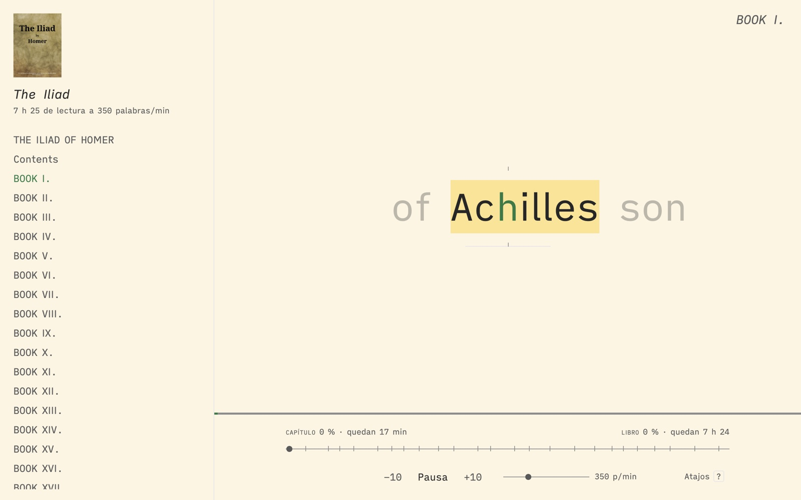
</p>

Every new chapter gets a breath: the screen empties for a moment and the title appears, like
the half-title page of a printed book.

<p align="center">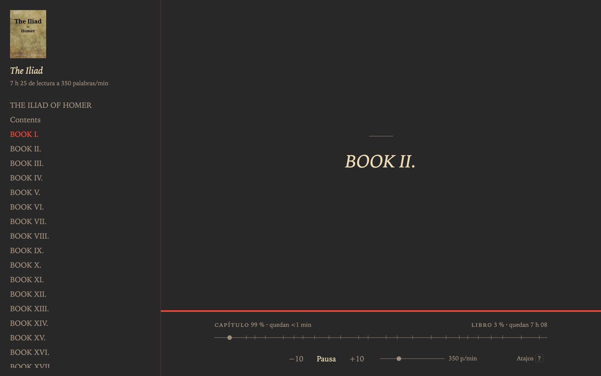</p>

## Stop

When you pause, the word you were reading flies to its spot in the full text. From there you
can browse the book, click any word to continue from it, or jump to a chapter from the table
of contents. At the bottom, the chapter bar and the book bar tell you how much is left.

<p align="center">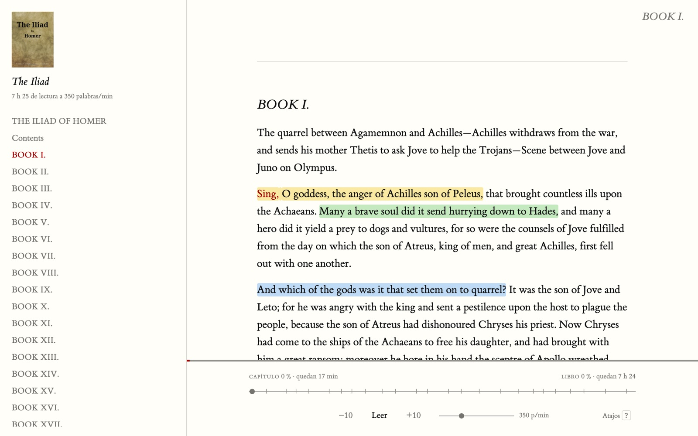</p>

How long is each chapter? **Ver › Tiempo por capítulo** (View › Time per chapter) shows it in
the table of contents, at your speed.

<p align="center">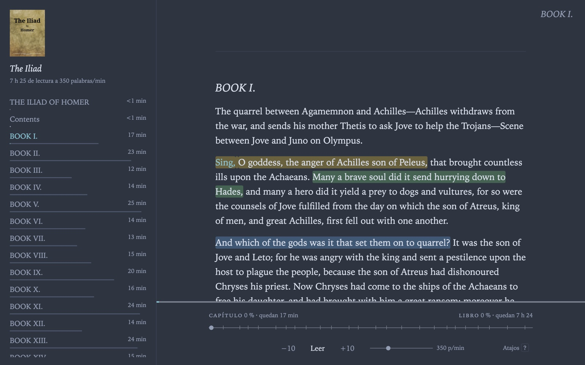</p>

## The golden apples

Press `S`, select a passage and pick its color: yellow, green, blue or pink. You can fix the
text and add a comment. Everything is saved as a Markdown note in your Obsidian vault, with
quotes grouped by chapter (see [Highlights and notes](#highlights-and-notes)).

<p align="center">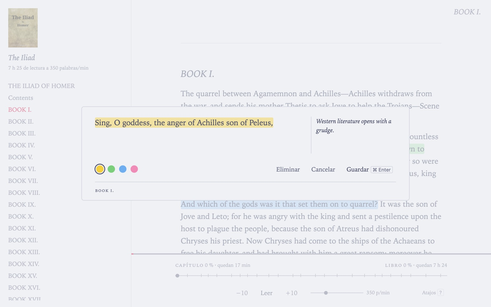</p>

## Twelve tracks to run on

Twelve color themes (**Ver › Tema**) and seven typefaces (**Ver › Tipo de letra**). Tufte and
Typewriter bring their own.

<p align="center">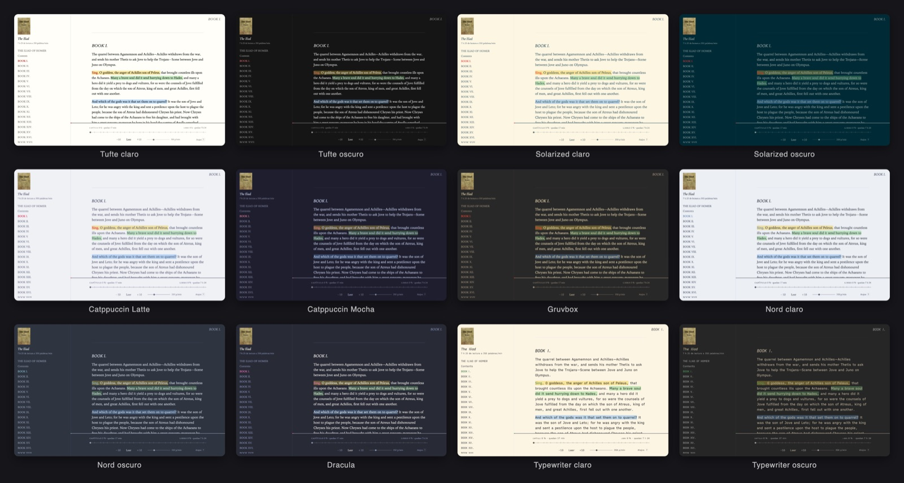</p>

## Back to the race

When you open the app, your last book is waiting with its cover, how far you've read and how
much is left. Press `Space` and go.

<p align="center">
  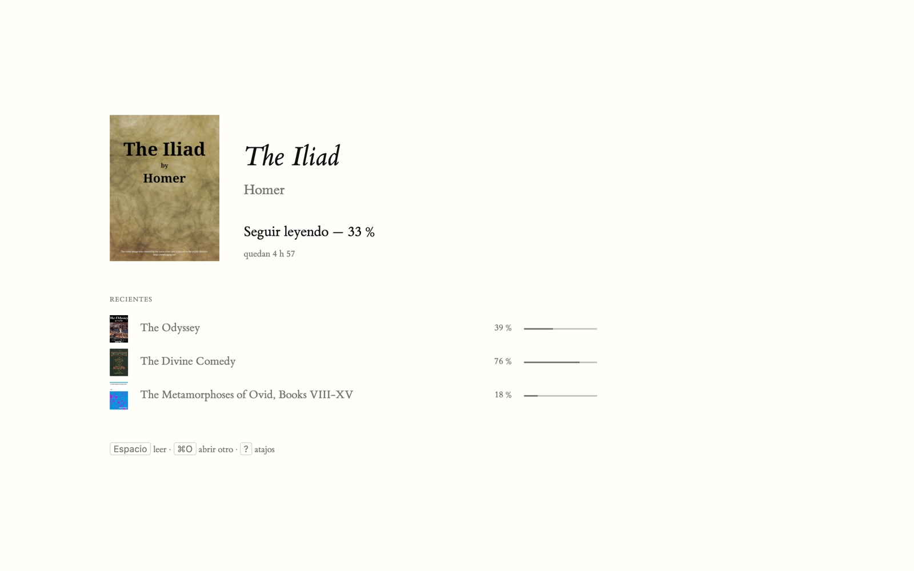
  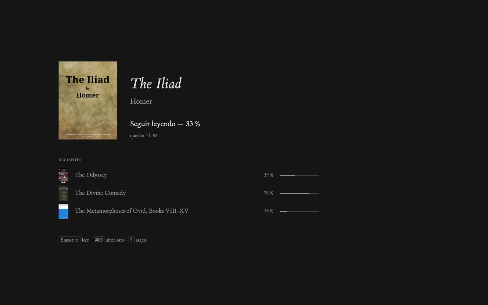
</p>

## Usage

- **Archivo › Abrir…** (File › Open, ⌘O) or **Abrir reciente** (Open recent). On launch you
  see the home screen, with your last book and the other recent ones; `Space` or `Enter`
  resumes the last one where you left off.
- When you resume after a pause of more than 3 seconds, reading goes back to the start of the
  sentence (at most 30 words back), unless you chose another word during the pause.
- All settings (themes, table of contents, chapter times, neighboring words, natural rhythm)
  are in the **Ver** (View) menu.
- Shortcuts: press `?` or **Ayuda › Atajos de teclado** (Help › Keyboard shortcuts, ⌘/).

<p align="center">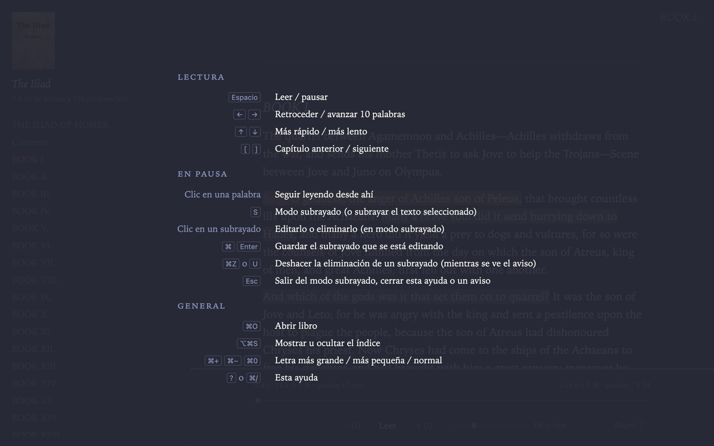</p>

| Key | Action |
|---|---|
| `Space` | Read / pause |
| `←` `→` | Back / forward 10 words |
| `↑` `↓` | Faster / slower |
| `[` `]` (or ⌘[ ⌘]) | Previous / next chapter |
| `S` | While paused: highlight mode, or highlight the selected text |
| `Esc` | Leave highlight mode / close the help |
| ⌥⌘S | Show or hide the table of contents |
| ⌘+ ⌘− ⌘0 | Larger / smaller / default text size (the whole interface scales together) |

## PDF

PDFs are read with pdf.js, inside the interface (the same on macOS, Windows and Linux). A PDF
only says which text goes where on the page, so Atalanta rebuilds the book: it joins lines into
paragraphs, rejoins hyphenated words, removes headers, page numbers and footnotes, detects
headings by font size and takes the table of contents from the PDF's bookmarks.
It works well with prose; math formulas can't be read word by word.
Scanned PDFs (with no text) aren't supported yet.

## Highlights and notes

1. **Archivo › Elegir carpeta de notas…** (File › Choose notes folder), for example a folder
   inside your Obsidian vault. If you haven't chosen one, you'll be asked when you save your
   first highlight.
2. Pause, press `S` and select a passage with the mouse. The editor opens: you can fix the
   text and add a comment. ⌘ Enter saves.
3. In highlight mode, clicking a highlight opens it to edit or delete it.

Two files are written per book in the notes folder:

- `Title.md`: the book's summary (`## Resumen`, if its metadata has one) and one section per
  source (`## Atalanta`, `## Kindle`, `## Kobo`), with quotes grouped by chapter, each with its
  comment. Atalanta only rewrites what's between its markers (`<!-- fastread:… -->`):
  anything you write outside them is kept.
- `.fastread/Title.json`: Atalanta's highlights, editable (Obsidian doesn't show folders that
  start with a dot).

The `.fastread` folder and the `fastread:` markers carry the app's former name (FastRead):
they're kept so existing notes keep working.

Every book you open gets its note, even without highlights, with reading properties that
Obsidian (Bases or Dataview) can gather into a table. Properties you add yourself are kept.

| Property | Value | When it changes |
|---|---|---|
| `progress` | % read (0–100) | on every pause and when switching books |
| `wpm` | speed (words per minute) | on every pause |
| `started` | date you first opened the book | once |
| `finished` | date you reached the end | once |
| `cover` | link to the cover, saved in `portadas/` | when the book is opened |

The cover (from the EPUB or MOBI metadata, or the first page of a PDF) shows at the start of
the text while paused and in the table of contents panel (**Ver › Portada en el índice**), and
is saved as a thumbnail in `portadas/` inside the notes folder. With an Obsidian Base in card
view, your book notes show up with their covers.

## Import from Kindle and Kobo

Connect the reader over USB and choose **Archivo › Importar subrayados de Kindle…** or
**…de Kobo…** (File › Import highlights from Kindle / Kobo). If the reader isn't found, you're
asked for the file:

- Kindle: `documents/My Clippings.txt`.
- Kobo: `.kobo/KoboReader.sqlite` (a hidden folder: in the file dialog, ⌘⇧. shows it).

Each import replaces that source's section in the books it brings; it doesn't duplicate on
re-import and doesn't touch other books. Kindle stores every edit of a highlight as a new
entry: the last one is kept, and comments are attached to their highlight.

Kindle doesn't store the chapter of each highlight. Atalanta works it out by searching for the
quote inside the book: on the Kindle itself or in the folders of your recent books. It needs
the book as a DRM-free EPUB or MOBI (books bought from Amazon won't work) with a table of contents.

## Commands

```sh
cd src-tauri
cargo tauri dev     # run in development mode (reloads when ui/ changes)
cargo tauri build   # build Atalanta.app and the .dmg in target/release/bundle/
```

### Windows and Linux

GitHub Actions (`.github/workflows/ci.yml`) runs the tests and builds the app on every push to
`main`. It also checks Rust dependencies for security advisories with cargo-deny, on every
push and every Monday (known advisories without a fix are listed in `deny.toml`; by hand:
`cargo deny check advisories`). The installers stay on the run's page (**Actions** tab,
*Artifacts* section) for 14 days:

- `Atalanta-Windows`: the `Atalanta_…_x64-setup.exe` installer and `atalanta.exe`, which runs
  without installing. They aren't signed: Windows warns the first time (**More info › Run
  anyway**).
- `Atalanta-Linux`: `.deb` (Ubuntu, Debian) and `.AppImage` (any distribution: `chmod +x` and
  open it).

## Tests

```sh
./test.sh
```

Runs the Rust tests (`cargo test -p atalanta-core`) and the interface tests (`node --test`,
nothing else to install). Worth running before every commit.

Each part has its own test folder:

- `core/tests/`: one test per file in `core/src`. Each source file ends with `mod tests`,
  pointing to its test, so tests can use internal functions. Their fixtures are in
  `core/tests/resources/`: the contents of an EPUB (`libro-de-prueba/`, which the tests zip),
  variants of its `content.opf` (`opf/`), a Kobo database (`kobo.sql`), a Kindle
  `My Clippings.txt`, an existing Obsidian note and the lines of a sample PDF (`pdf-paginas.json`).
- `ui-tests/`: tests for what lives in the interface (`*.test.js`). They're outside `ui/` so
  they aren't bundled into the app. `load-ui.js` loads the `ui/` files in a simulated
  environment (no browser, no Tauri) to test their functions.

## Where things are

The project is a Cargo *workspace* with two crates: **`core`**, all the logic without an
interface (reusable with another interface), and **`src-tauri`**, the app, which only connects
`core` to the web interface in `ui/` through commands.

| File | What it does |
|---|---|
| `ui/index.html` | Window structure, shortcuts help and highlight editor |
| `ui/style.css` | Color themes, sizes, typography |
| `ui/app.js` | Reading, views (reader and full text), table of contents, settings and keyboard |
| `ui/home.js` | Home screen: last book and recent ones |
| `ui/pdf-reader.js` | Extracts lines, bookmarks and cover from a PDF with pdf.js (`ui/vendor/pdfjs`) |
| `ui/rhythm.js` | Time per word at the chosen speed, gradual start and where to resume |
| `ui/notes.js` | Highlights: highlight mode, editor, their data and the reading properties |
| `ui/import.js` | Choosing the Kindle and Kobo files and reporting the import result |
| `ui/menu.js` | Main menu and recent books |
| `core/src/book.rs` | Reads EPUB/MOBI: words, paragraphs, formatting, table of contents, title, author and summary |
| `core/src/pdf.rs` | Rebuilds a book from the lines of a PDF |
| `core/src/rhythm.rs` | Pause for each word (natural rhythm), dialogue and section breaks |
| `core/src/notes.rs` | Obsidian notes: sections, summary, properties and file names |
| `core/src/kindle.rs` | Reads and imports a Kindle's My Clippings.txt |
| `core/src/kobo.rs` | Reads and imports highlights from a Kobo's database |
| `core/src/chapters.rs` | Finds which chapter of a book each quote is in (for Kindle) |
| `core/src/cover.rs` | Extracts the cover of an EPUB or MOBI |
| `src-tauri/src/main.rs` | Starts the app and exposes `core` to the interface as commands (`open_book`, `pdf_book`, `notes_*`, `import_*`…) |

Easy changes:

- Pause for each word (natural rhythm): the `PAUSE_*` constants at the top of `core/src/rhythm.rs`.
- Timing of chapter changes, blinking and resuming: values at the top of `ui/rhythm.js`.
- A new theme: 6 colors in `ui/style.css` and one line in `THEMES` (`ui/app.js`).
- Word size: `#word` in `ui/style.css`. Speed range: `index.html` (`min`/`max`) and `setWpm()`.

## Credits

- Fonts included in `ui/fonts`, each with its license:
  - **ET Book** (Dmitry Krasny, Bonnie Scranton and Edward Tufte): MIT license.
  - **Atkinson Hyperlegible** (Braille Institute): SIL Open Font License 1.1.
  - **iA Writer Quattro** (Information Architects, based on IBM Plex): SIL Open Font License 1.1.
- Iowan Old Style, New York, Charter and San Francisco are macOS system fonts.
- **pdf.js** (Mozilla), in `ui/vendor/pdfjs`: Apache 2.0 license.
- Color themes based on Tufte CSS, Solarized, Catppuccin, Gruvbox, Nord, Dracula and
  obsidian-typewriter.
- The screenshots use public-domain books from [Project Gutenberg](https://www.gutenberg.org):
  *The Iliad* and *The Odyssey* (Homer, translated by Samuel Butler), *The Divine Comedy*
  (Dante, translated by Henry Francis Cary) and *The Metamorphoses of Ovid*
  (translated by Henry T. Riley).

## A note on macOS permissions

The first time Atalanta opens a book from the Documents folder, macOS asks for permission.
With every new build (`cargo tauri build`) macOS treats it as a different app and asks again.
